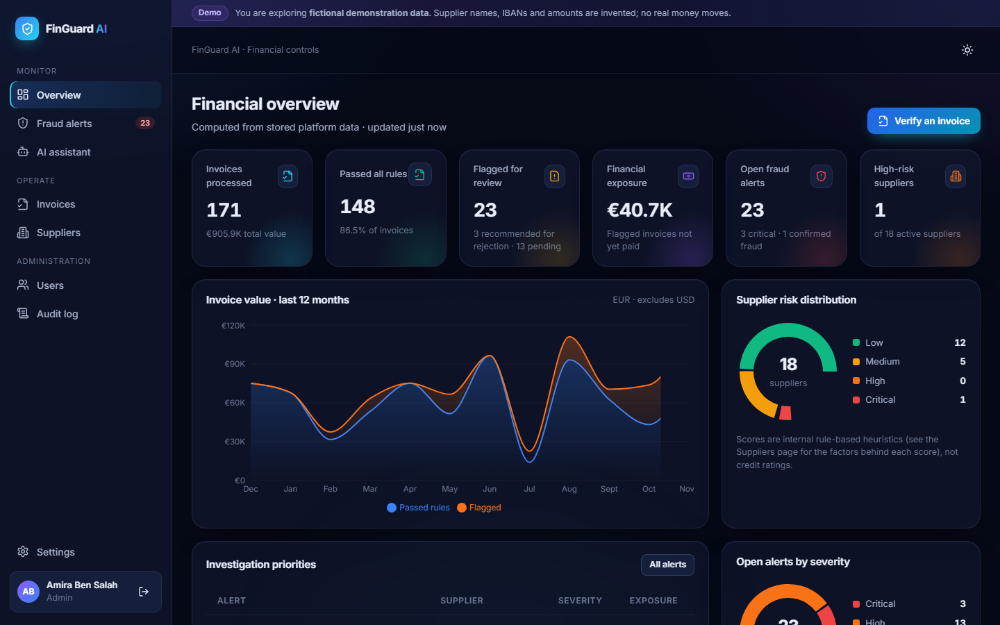
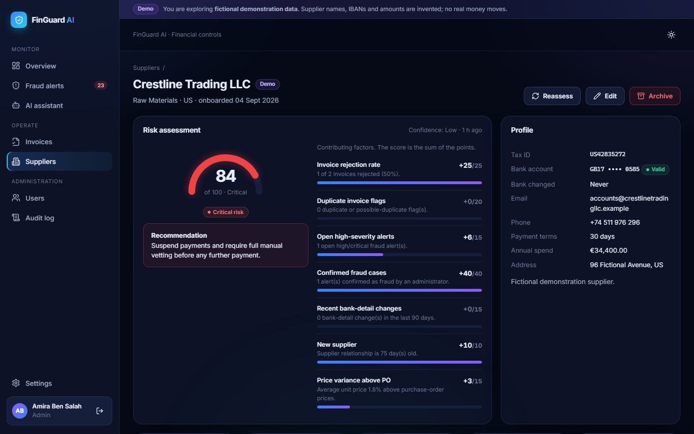
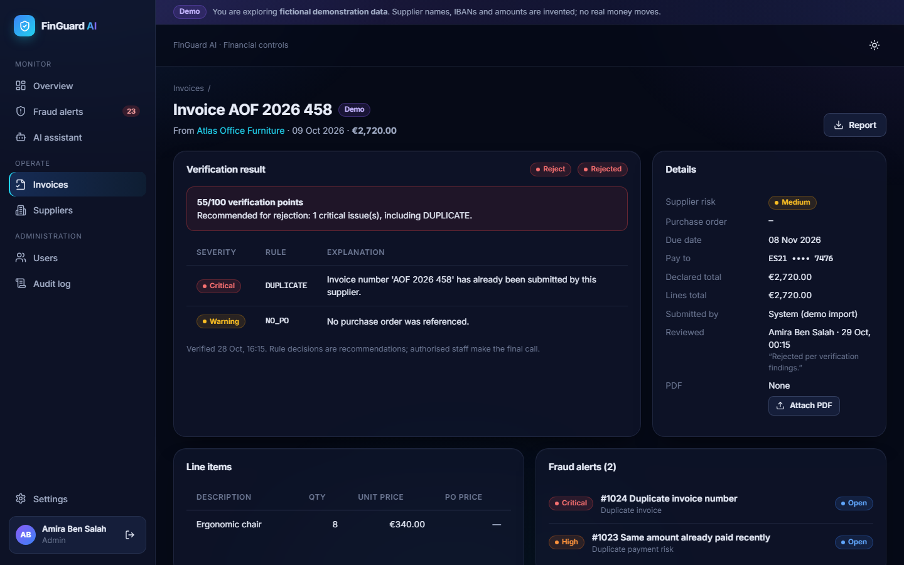
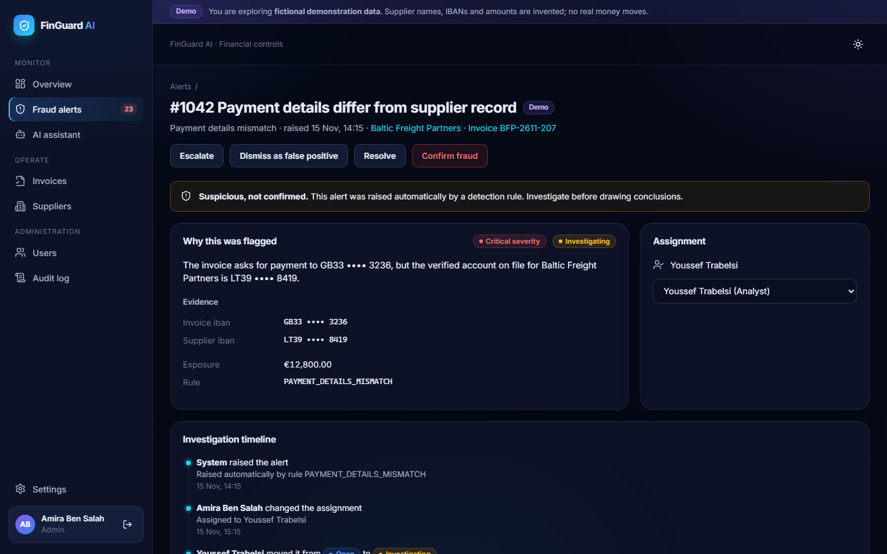
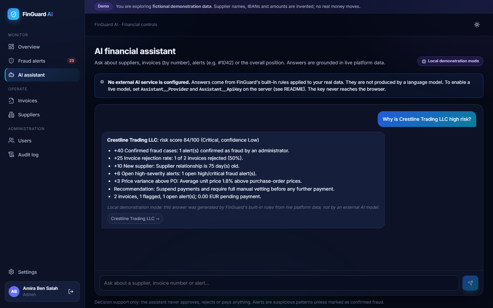
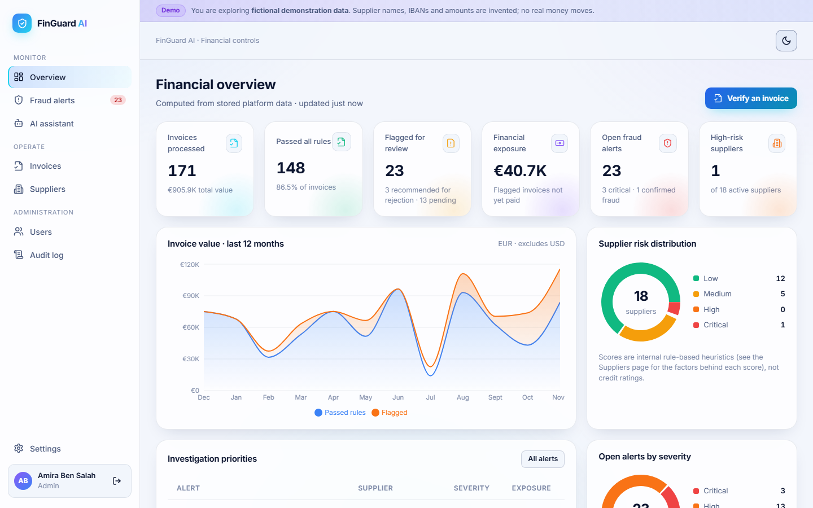
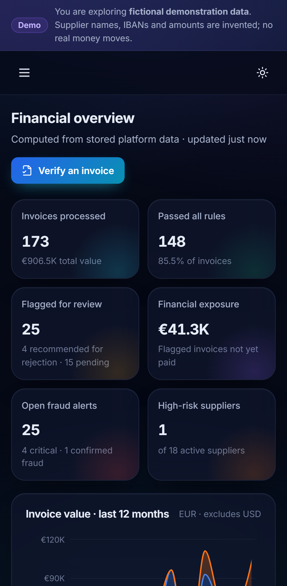
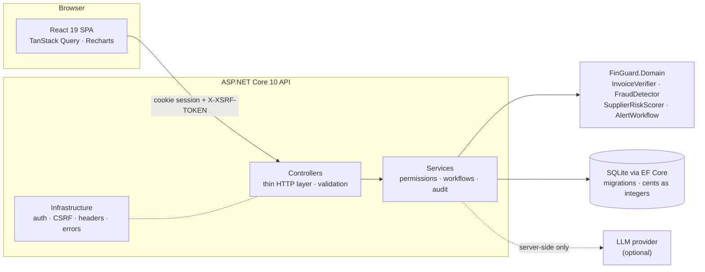

<div align="center">

# FinGuard AI

**Explainable financial controls for accounts payable.**
Invoice verification · Supplier risk intelligence · Fraud detection & investigation · Grounded AI assistant




</div>

> **Portfolio project.** All demonstration data is fictional, generated by a reproducible seeder. FinGuard never moves money: "Mark paid" records a simulated payment.

## Why FinGuard

Invoice fraud rarely looks dramatic. It looks like a resubmitted invoice number, a supplier whose bank account "changed" last week, or three invoices that each sit just under the approval limit. Small finance teams catch these by hand, inconsistently, and without an audit trail.

FinGuard runs **deterministic, documented rules** on every invoice, **explains every finding in plain language**, scores suppliers with a **transparent 0–100 model**, and routes suspicious activity into an **investigation workflow**. Humans stay in charge of every decision. Rule outcomes are recommendations, and only an administrator can confirm fraud.

## Screenshots

| Supplier risk analysis | Invoice verification |
|---|---|
|  |  |
| Every point of the 0–100 score is attributed to a documented factor, with a recommendation and confidence level. | A resubmitted invoice rejected as a duplicate: `AOF 2026 458` matches the earlier `AOF-2026-0458` because separators, casing and zero-padding are normalised in every number group. |

| Fraud alert investigation | AI financial assistant |
|---|---|
|  |  |
| A payment-redirection pattern: masked IBAN evidence, assignment and an investigation timeline. Labelled *suspicious, not confirmed*. | Answers grounded in platform data. Without an API key it runs in an explicitly labelled local mode. |

| Light theme | Mobile |
|---|---|
|  |  |

## Features

**Financial overview**: KPIs, 12-month invoice trend, risk distribution, alert severity, most frequent findings, spend by category, investigation priorities and recent activity. Every figure is computed server-side from stored data, and every KPI links to the filtered list behind it.

**Supplier risk intelligence**
- Create, edit, archive and restore suppliers, with search, filters, sorting and pagination.
- Explainable 0–100 risk score from 7 capped factors (rejections, duplicates, open alerts, confirmed fraud, bank-detail changes, new relationship, price variance), plus confidence and a recommendation.
- Risk history chart, bank-detail change log, and side-by-side comparison of 2–4 suppliers.

**Invoice verification**
- 12 verification rules: duplicates, arithmetic, PO match, supplier and currency mismatch, over-PO, price and quantity increases, line validation.
- Duplicate detection normalises invoice numbers group by group: `AOF-2026-0458`, `aof 2026 458` and `AOF2026/458` match, while `INV-12-3` and `INV-1-23` stay distinct.
- PDF upload validated by extension, content type **and** file signature. Fields are extracted from text PDFs, and the supplier is matched by IBAN, tax ID or name.
- Review workflow with **segregation of duties** (you can't approve your own invoice) and admin approval above a threshold or for high-risk suppliers.
- Payment controls: payments always go to the supplier's verified account, never to an account printed on the invoice, and are blocked while high or critical alerts are open. Only administrators can change bank details.
- Downloadable, HTML-escaped verification report.

**Fraud detection & alerts**
- 9 rules: payment-detail mismatch, invalid IBAN, recent bank change, amount outlier, split invoicing, just-below-threshold, round amounts, future dates, duplicate-payment risk.
- Severity levels, assignment, notes and a full timeline. Workflow transitions are enforced by role, and only administrators can mark an alert *Confirmed fraud*.

**AI financial assistant**: explains risk scores, summarises invoices and alerts, compares suppliers and recommends investigation order. It works with Anthropic or any OpenAI-compatible API, **from the backend only**: the key never reaches the browser, the model only receives financial facts (no supplier contact details), and live answers are labelled as AI-generated.

**Security & administration**: registration, login, logout, password reset, lockout, rate limiting, Admin/Analyst roles, user administration and an audit log. See [Security](#security).

## Architecture



- **Domain** is a dependency-free library, so every rule is unit-tested in isolation.
- **Controllers contain no business logic.** Services enforce permissions on the server; UI buttons only mirror them.
- **One origin in production:** the API serves the built SPA from `wwwroot`, keeping `SameSite=Strict` session cookies. In development, Vite proxies `/api`.
- **Why SQLite:** the app runs straight after cloning, with no database server or Docker. Money is stored as integer cents, so sums and ordering stay exact. Moving to SQL Server or PostgreSQL means changing the EF Core provider and adding a migration.

Detailed docs: [detection rules](docs/DETECTION_RULES.md) · [risk scoring](docs/RISK_SCORING.md) · [security design](docs/SECURITY.md)

## Tech stack

| Layer | Technologies |
|---|---|
| Backend | ASP.NET Core 10 Web API, C#, EF Core 10 (SQLite), cookie auth + antiforgery, built-in rate limiter, RFC 7807 problem details, OpenAPI + Scalar, health checks, PdfPig |
| Frontend | React 19, TypeScript, Vite, React Router, TanStack Query, Recharts, custom CSS design system (dark/light, glass panels) |
| Testing | xUnit, `WebApplicationFactory`, Vitest, Testing Library, Playwright |
| CI | GitHub Actions: backend, frontend, end-to-end and dependency-audit jobs |

## Getting started

**Prerequisites:** .NET SDK 10 and Node.js 20.19+.

```bash
git clone https://github.com/ranimedogaz1234-dot/finguard-ai.git
cd finguard-ai

# Build the frontend into the API's wwwroot, then run everything from one address
cd web && npm install && npm run build && cd ..
dotnet run --project src/FinGuard.Api          # http://localhost:5080
```

On first start the API creates `src/FinGuard.Api/App_Data/finguard.db`, applies migrations and seeds fictional demo data (Development only). Open http://localhost:5080 and sign in with a demo account:

| Role | Email | Password (demo only) |
|---|---|---|
| Admin | `admin@finguard.demo` | `FinGuard-Demo-2026!` |
| Analyst | `analyst@finguard.demo` | `FinGuard-Demo-2026!` |
| Analyst | `lina.analyst@finguard.demo` | `FinGuard-Demo-2026!` |

**Frontend dev server with hot reload:** run `cd web && npm run dev` (http://localhost:5173) while the API is running.
**API reference:** http://localhost:5080/scalar (Development only).

### Things to try

1. **Overview:** click any KPI to open the filtered list behind it.
2. **Suppliers → Crestline Trading LLC:** a confirmed-fraud case; see which factors drive its score.
3. **Suppliers → Baltic Freight Partners:** bank details changed 12 days ago, and the next invoices raised alerts.
4. **Invoices → New invoice:** submit the same number twice, then try to approve your own invoice.
5. **Fraud alerts:** start an investigation as an analyst, then confirm or dismiss it as admin.
6. **Assistant:** "What should I investigate first?"

## Configuration

Settings come from `appsettings.json`, are overridden per environment and by environment variables (`Section__Key`), and use **user-secrets for secrets**. See [`.env.example`](.env.example).

| Key | Default | Purpose |
|---|---|---|
| `ConnectionStrings:Default` | `Data Source=App_Data/finguard.db` | SQLite file, relative to the API's content root |
| `Demo:Seed` / `Demo:Password` | on in Development | Seed fictional data into an empty database |
| `Finance:ApprovalThreshold` | `10000` | Invoices at or above this need admin approval |
| `Assistant:Provider` | `None` | `None` (labelled local mode), `Anthropic` or `OpenAI` |
| `Auth:AllowRegistration` | `true` | Self-registration; new users are Analysts |
| `Auth:BootstrapAdminEmail` | unset | The only email that can become the first administrator on an empty system |
| `Auth:AbsoluteSessionMinutes` | `720` | Absolute session lifetime, regardless of activity |

```bash
# Enable a live AI model. The key stays on the server.
dotnet user-secrets set "Assistant:Provider" "Anthropic"  --project src/FinGuard.Api
dotnet user-secrets set "Assistant:ApiKey"   "<your key>" --project src/FinGuard.Api
dotnet user-secrets set "Assistant:Model"    "<model id>" --project src/FinGuard.Api
```

**Demo vs. real data:** every seeded row has `IsDemo = true`, shows a **Demo** badge and triggers a banner. Admins can remove it all under *Settings → Remove demo data*, and it isn't re-seeded afterwards.

## Testing

```bash
dotnet test                                                    # domain + API integration/security
cd web && npm test                                             # component tests
cd web && npm run build && npx playwright install chromium && npm run e2e   # E2E, desktop + mobile
```

### Verified results

All suites were run locally on 18 Nov 2026 (Windows 11, .NET SDK 10.0.404, Node 26.13). CI runs the same suites on every pull request.

| Suite | Scope | Result |
|---|---|---|
| Domain unit tests (xUnit) | verification rules, fraud rules, risk scoring, alert workflow, IBAN | **71 / 71 passed** |
| API integration & security (xUnit + `WebApplicationFactory`, seeded SQLite) | auth, lockout, CSRF, RBAC, object-level access, segregation of duties, admin bootstrap, absolute session lifetime, bank-detail and payment controls, request limits, information exposure, duplicate detection through the API, uploads, XSS-safe reports, search/filter binding, dashboard consistency, assistant | **60 / 60 passed** |
| Frontend components (Vitest) | formatting, accessible widgets, safe rendering, login/registration | **13 / 13 passed** |
| End-to-end (Playwright) | 12 user journeys on desktop Chrome **and** Pixel 7 emulation (24 runs), including a no-horizontal-overflow check on 10 pages, plus 2 screenshot-capture tests | **26 passed**, 2 skipped by design (each capture runs on one viewport) |
| Dependency audit | `dotnet list package --vulnerable`, `npm audit` (production and development dependencies) | **0 known vulnerabilities** |

Bugs these suites caught during development:
- configuration was read before the host finished building;
- an MVC antiforgery filter depended on Razor view services;
- query-string prefix binding silently dropped list filters;
- ICU-dependent currency formatting;
- mobile layout overflow;
- percent formatting;
- duplicate detection that missed zero-padded invoice numbers in inner groups (`AOF-2026-0458` vs `AOF 2026 458`).

## Security

Every control is mapped to OWASP and to the tests that verify it in [docs/SECURITY.md](docs/SECURITY.md), together with the residual risks. Highlights:

- **Access control:** deny-by-default authorization, object-level checks on alerts, segregation of duties, and admin-only bank-detail changes, payments and fraud confirmation.
- **Sessions:** HttpOnly / `SameSite=Strict` cookies, an 8-hour sliding window with a 12-hour absolute limit, and revocation on password reset, role change or deactivation.
- **Credentials:** PBKDF2 password hashing, lockout and rate limits. Registration never grants admin rights; only a configured owner email can bootstrap the first administrator.
- **Requests:** CSRF tokens, request-body size limits, strict CSP and security headers.
- **Data:** signature-checked PDF uploads parsed with a time budget, masked IBANs everywhere, an audit log of sensitive actions including denied bank-detail changes, and no business thresholds exposed to anonymous users.

No real credentials are in the repository. The only committed password belongs to the **fictional demo accounts**, which are seeded in the Development environment only and refused in Production.

## Limitations & roadmap

**Current limitations**
- Detection is rule-based; there's no machine-learning model, and thresholds live in code and configuration.
- PDF extraction reads text PDFs; scanned images would need OCR.
- There's no email provider: in Development, reset links go to a local outbox.
- No MFA yet, and rate limiting is in-memory (single instance).
- Dashboards aggregate one base currency, with no FX conversion.
- The frontend ships as one ~860 kB bundle (245 kB gzipped).

**Roadmap:** MFA (TOTP/WebAuthn) · email delivery · OCR · configurable rule thresholds · multi-tenant organisations · PostgreSQL deployment profile · anomaly-detection model alongside the rules · route-level code splitting · Recharts 3 · container and cloud deployment.

## Author

Built by **Ranime Doggaz**. No open-source license has been chosen yet, so all rights are reserved by the author.
